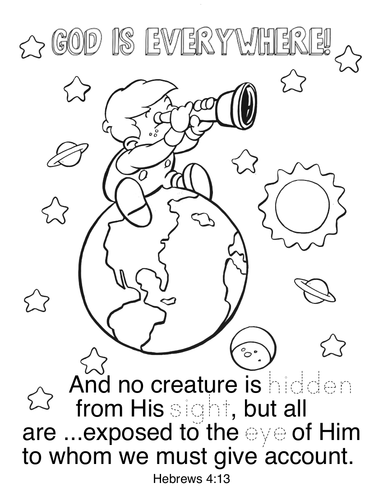

# 🧭 [Lesson 12: The Consequences of Sin and the Birth of Cain and Abel](../README.md)

## 🚀 Activities

### 🎵 Songs

- Nothing But the Blood
- The Wise Man
- Sandyland

### 🖍️ Coloring Page

- #### Hebrews 4:13

---

⬅️ [Go Back to 🧭 Lesson 12](../README.md)
