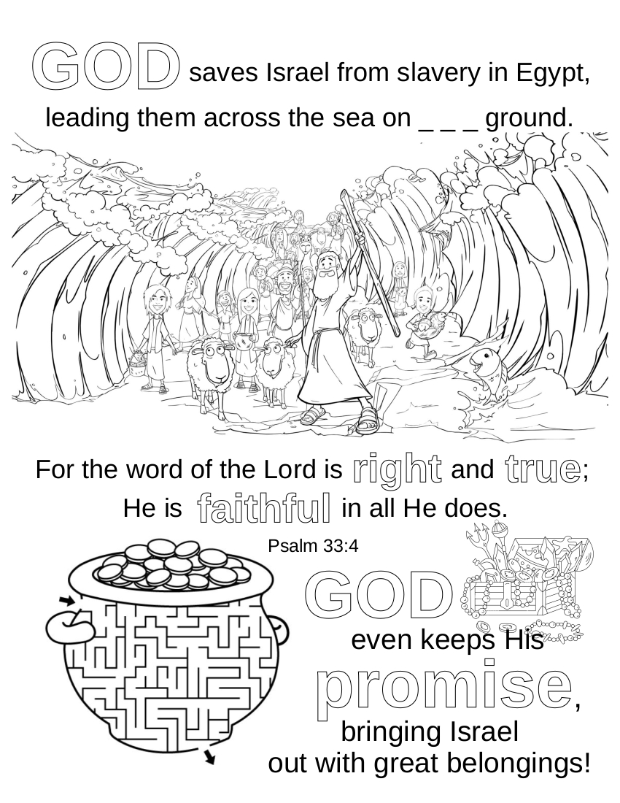

# 🧭 [Lesson 24: God Saved Israel at the Red Sea](../README.md)

## 🚀 Activities

### 🎵 Songs

- Thankyou Lord
- God is so Good
- Father Abraham

### 🖍️ Coloring Page

- #### God Saved Israel From Slavery

---

⬅️ [Go Back to 🧭 Lesson 24](../README.md)
