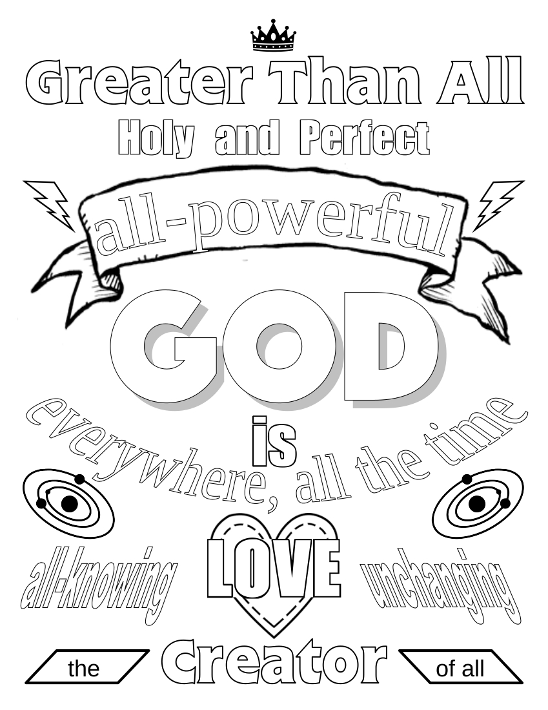

# 🧭 [Lesson 3: God Created the Angels](../README.md)

## 🚀 Activities

### 🎵 Songs

- I Have Decided
- Trust and Obey
- Believe on the Lord Jesus Christ

### 🖍️ Coloring Page

- #### GOD – Who He Is

---

⬅️ [Go Back to 🧭 Lesson 3](../README.md)
