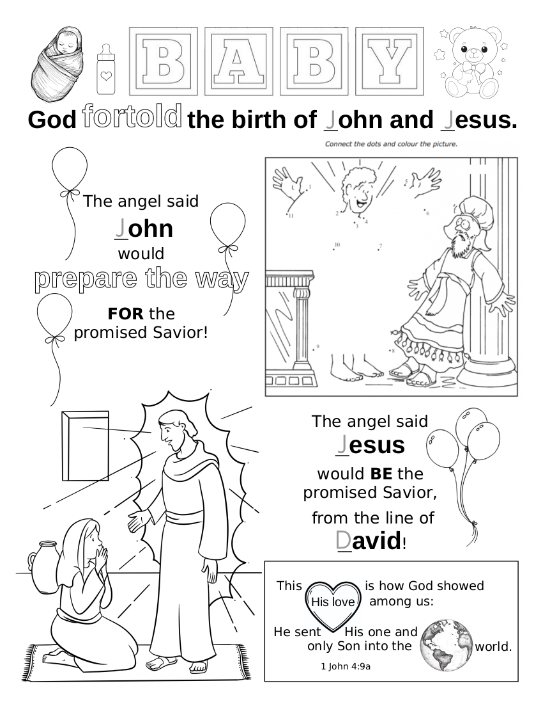

# 🧭 [Lesson 32: God Foretold the Birth of John and Jesus](../README.md)

## 🚀 Activities

### 🎵 Songs

- Believe on the Lord Jesus Christ, Acts 16:31
- Books of the Bible
- The B-I-B-L-E
- He's Got the Whole World in His Hands

### 🖍️ Coloring Page

- #### God foretold the Birth of John and Jesus

---

⬅️ [Go Back to 🧭 Lesson 32](../README.md)
