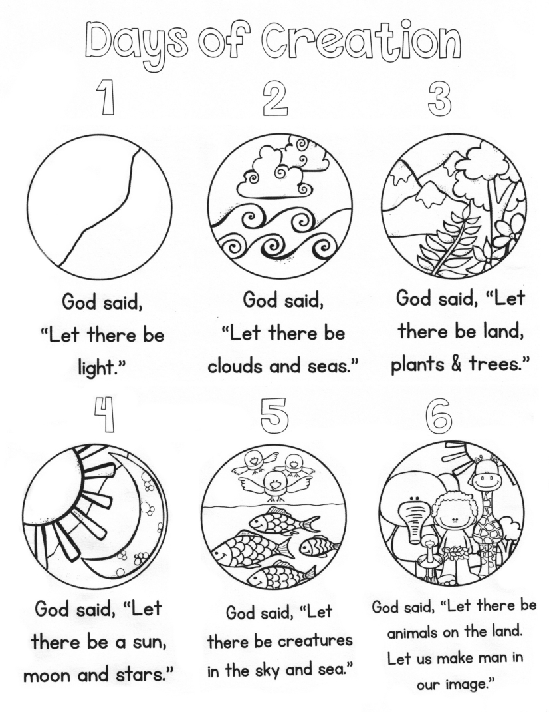
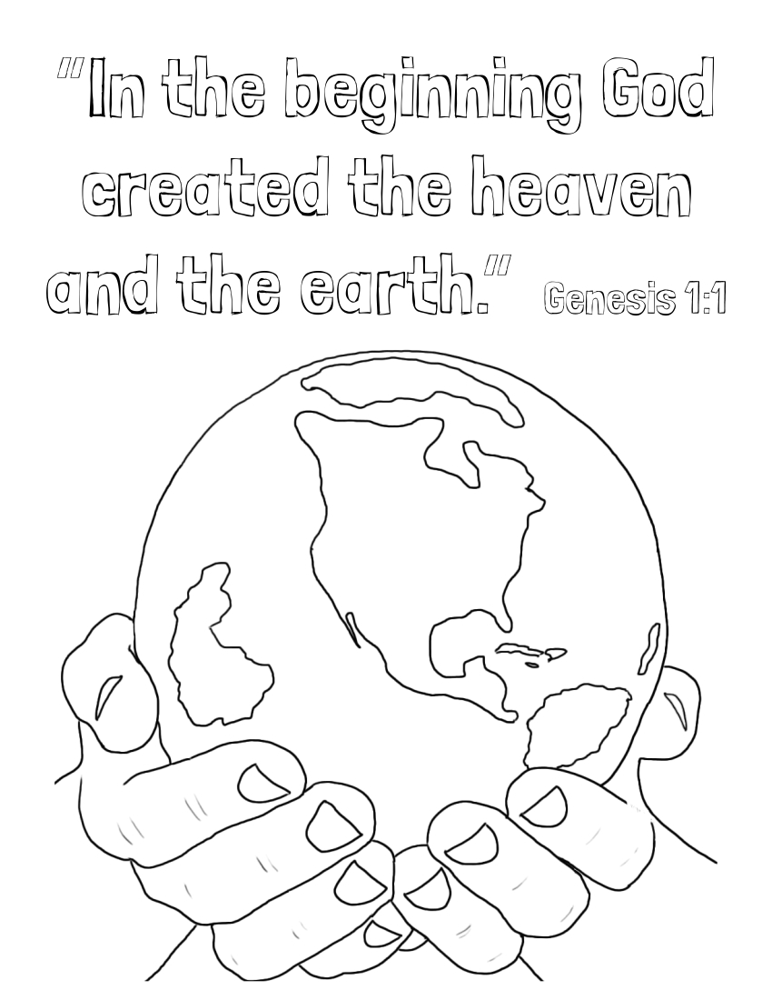

# 🧭 [Lesson 4: God Created the Heavens and the Earth - Days 1 and 2](../README.md)

## 🚀 Activities

### 🎵 Songs

- Awesome God
- My God is so Great
- He's Got the Whole World in His Hands

### 🖍️ Coloring Page

- #### Days of Creation

- #### Genesis 1:1

---

⬅️ [Go Back to 🧭 Lesson 4](../README.md)
